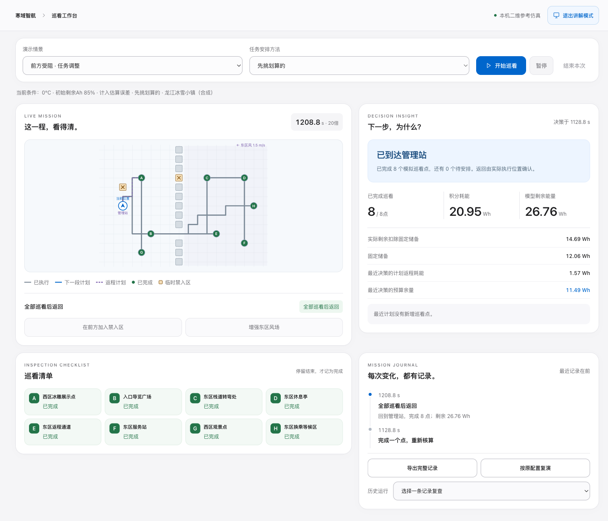

# 寒域智航

**面向东北冰雪场景的无人机任务决策与仿真验证平台。**

天冷、电量有限，一架无人机应该先查看哪些地方？途中遇到强风或临时禁入区，怎样调整任务，并把返程电量一起算进去？

寒域智航把这个过程做成了可以操作、解释和复查的本机软件：**出发前安排，途中按变化调整，回来后核对结果。** 当前重点是4C参赛开发版，使用合成的黑龙江冰雪小镇场景，模拟一架无人机对八个可延期地点进行补充巡看。

[快速试用](#快速试用) · [五步操作说明](competition/v2/TRY_IT.md) · [实验结果与证据](competition/v2/evidence/README.md) · [技术余项](competition/v2/TECHNICAL_REMAINING.md)

**10月29日发布（10月28日验证）：** [下载独立离线演示包与90秒备用视频](https://github.com/Am1cus/hanyu-zhihang/releases/tag/v2-demo-20261028)。已在Apple芯片Mac的全新环境中完成离线安装、87项检查、服务重启与复演；Windows目标电脑验收仍待完成。见[本轮交付记录](competition/v2/DAY28_DELIVERY.md)。当前界面保留作技术验证入口，后续前端重写可使用[后端接口交接](competition/v2/BACKEND_HANDOFF.md)。



*当前交付版的实际程序截图：合成场景、20倍仿真播放，与备用录屏对应同一轮运行。*

## 可以做什么

| 操作 | 能看到什么 |
|---|---|
| 改变温度和初始电量 | 同一任务的可用能量、返程预算和安排如何变化 |
| 比较四种任务安排方法 | 按清单走、先去近处、先挑划算的、把整趟一起算 |
| 开始仿真，加入障碍或改变风场 | 从实际执行位置重新核算，显示路线、任务和调整原因 |
| 暂停、继续、刷新网页 | 保留同一次运行；断连时明确提示并自动重连 |
| 查看历史、导出、从头复演 | 配置、事件、轨迹、原始电压电流和决策记录可追溯 |
| 尝试电量不足或超出模型范围 | 如实显示拒绝、信息不足或失败，不把它们记成成功返回 |

核心演示无需无人机、GPU、Java、AirSim或旧LSTM服务。位置和轨迹来自后端执行状态，网页不自行编造飞行动画。

## 快速试用

需要 **Python 3.12**。下面的源码克隆方式首次安装依赖需要联网；Release独立包带离线依赖，Python需预装。

```bash
git clone https://github.com/Am1cus/hanyu-zhihang.git
cd hanyu-zhihang
```

**macOS：** 双击仓库根目录的 [启动寒域智航.command](启动寒域智航.command)，或在终端执行：

```bash
zsh competition/v2/start_v2.command
```

**Windows：** 安装Python 3.12及Python Launcher后，双击 [competition/v2/start_v2.bat](competition/v2/start_v2.bat)。脚本已提供，v2的Windows实机验证仍待完成。

启动器会建立项目专用环境、检查固定版本依赖，然后打开 **http://127.0.0.1:8094/**。保持启动窗口开着，退出时按`Control+C`。服务重启后历史记录可查看和从头复演，不支持从上次位置接着飞。

第一次只需保持默认情景，点击“开始巡看”，观察前方受阻后的调整，返回后点“导出完整记录”。详细操作见[试用说明](competition/v2/TRY_IT.md)。

## 方法与实现

- **任务取舍：** 把地点价值、访问顺序、当前电量和返程一起考虑；提供三种基础方法与子集动态规划对照。静态当前观测下的最优安排，不等于未知未来下总能最好。
- **路线与预算：** 有向航段代价考虑风对地速和航行时间的影响，返程单独计算；遇到变化后从实际位置更新决策，规划器不读取未来事件。
- **低温参考：** 使用Molicel P42A厂家指定工况的参考曲线，−10℃由节点间插值得到；超出参考范围明确显示未覆盖。参数来源见[参数登记](competition/v2/data/parameter_sources.json)。
- **可复查执行：** 固定步长仿真，分别记录Wh和Ah，保留原始V/I/t；场景、版本和配置指纹共同约束复演。
- **技术栈：** Python、FastAPI、SQLite；v2界面使用原生HTML/CSS/JavaScript，由本机服务直接提供，无需前端构建步骤。

## 已完成的验证

以下是截至2026年10月27日的**软件验证**，均保留失败与不占优结果：

| 检查 | 结果与范围 |
|---|---|
| 软件检查 | 87项通过，覆盖算法、预算、执行、接口、复演与启动入口 |
| 固定条件比较 | 4张合成地图、3个温度、4类情境、3种估计偏差、4种方法、2种预算规则，共1,152项执行；抽取24项复演一致 |
| 储备比例补充比较 | 10% / 20% / 30%，共3,456项；其中1,152项是原20%设置的复核，不能计作新增独立样本 |
| 浏览器操作 | 正常、强风、障碍三轮完整演示，以及刷新、断连、超时、导出和服务重启检查 |

统筹安排并非每次都胜出：在计入估计误差的144组同条件比较中，相对就近安排为**38组更好、96组持平、10组更差**；低预算分组仍有弱项。具体指标、全部逐项统计和解释边界见[公开证据索引](competition/v2/evidence/README.md)。

运行软件检查（在仓库根目录，已安装比赛依赖）：

```bash
# macOS / Linux
.competition-venv/bin/python -m unittest discover -s competition/v2/tests -v

# Windows
.competition-venv\Scripts\python.exe -m unittest discover -s competition/v2/tests -v
```

## 展示边界

当前作品是**单机、固定高度、二维参考仿真**。地图和任务优先级为合成假设，停留表示一次模拟补充巡看，尚未包含拍照识别、真实配送或现场处置。

低温模型使用指定电芯的4.2A恒流参考条件和理想4S1P虚拟组，不模拟自热、老化、高倍率或真实飞控。固定储备比例和估计误差范围是仿真策略参数，不是真机安全标准。当前真实飞行验证为0，结果不能直接用于实际无人机安全决策。

独立交付包与同版备用视频已提供；Windows目标电脑验证、实际投影播放和真人答辩演练仍待完成。学生实际贡献、调研和工具使用按真实记录填写，不把自动测试计作真人试用。

## 仓库导航

```text
competition/v2/       当前4C开发版：决策、运行、界面、测试及证据摘要
competition/core/    复用的参考曲线、路径规划与存储
competition/data/    带来源的电芯参考参数
competition/web/     v1的Vue界面，保留历史
Phase1/ … Phase5/    数据、LSTM、AirSim与离线规划研究过程
platform/            原研究平台的Vue与Spring Boot源码
demo/                原研究平台的启动和回放工具
docs/                项目台账、研究说明与操作资料
```

原研究平台保留为研究支线：V3 LSTM预测未来10秒耗电Ah，尚待独立确认，不接入v2未飞路线的任务预算。历史负结果和研究进度见[项目台账](docs/PROJECT_PROGRESS.md)、[Phase5说明](Phase5/README.md)和[原平台启动说明](demo/README.md)。

本仓库发布源码、必要参数、测试夹具和结果摘要。完整遥测档案、运行数据库、虚拟环境、旧数据包及本机配置不随源码上传；公开逐项统计不等于提供了全部原始实验档案。
